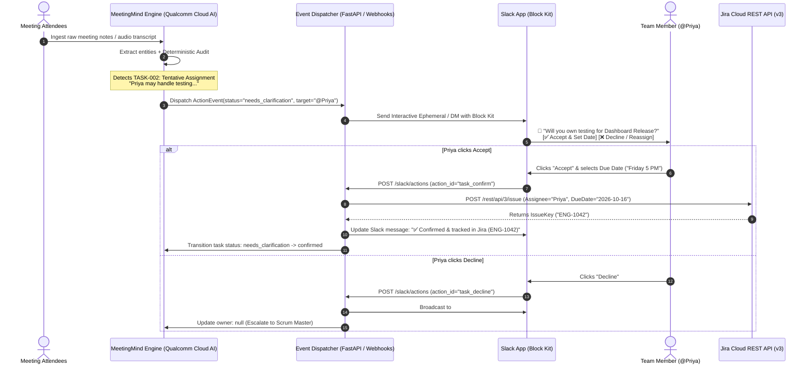
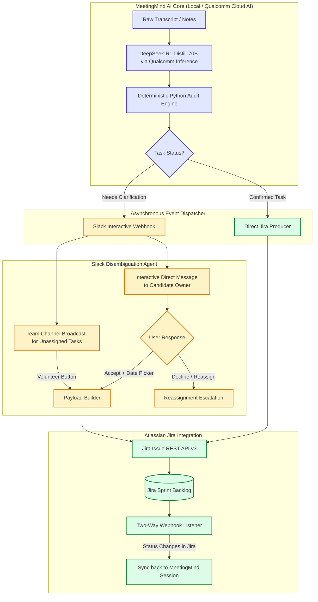

# MeetingMind AI: Future Workflow Specification
## Closed-Loop Action Resolution via Slack Disambiguation & Jira Synchronization

---

## 1. Executive Summary

In its current production release (v1.0), **MeetingMind AI** implements **Deterministic Anti-Hallucination Guardrails**. When meeting notes contain unconfirmed commitments (e.g., *"Priya may handle testing, but has not confirmed"*), missing owners, or vague timelines (*"soon"*), the engine refuses to fabricate data, flags the items with evidence quotes, and generates targeted **Clarification Questions** on the dashboard.

This document specifies the **v2.0 Closed-Loop Active Grounding Architecture**, moving beyond passive dashboard alerts into automated, asynchronous resolution:
1. **Slack Disambiguation Agent:** Proactively pings team members via interactive Slack Block Kit messages to confirm tentative tasks, specify deadlines, or volunteer for unassigned work.
2. **Bi-Directional Jira Engine:** Automatically converts verified action items into structured Jira issues (Tasks, Bugs, Spikes), complete with verbatim quote citations, confidence metrics, and sprint linking.

---

## 2. End-to-End System Architecture



---

## 3. Component Architecture & Data Flow



---

## 4. The Slack Disambiguation Agent Specification

### 4.1 Message Types & Triggers

| Trigger Condition | Target Slack Destination | Interactive UI Components |
|---|---|---|
| **Tentative Owner** (`TASK-002`) | Direct Message (DM) to identified individual | • Accept button<br/>• Decline button<br/>• Date picker element |
| **Unassigned Task** (`TASK-004`) | Team Sprint Channel (e.g. `#eng-sprint`) | • "Volunteer to Own" button<br/>• "Assign Teammate" user-select dropdown |
| **Vague Deadline** (`"soon"`, `"next week"`) | DM to Confirmed Owner | • Inline Date Picker modal<br/>• Sprint Milestone dropdown (e.g. "Sprint 24 End") |
| **Unresolved Architectural Decision** | Engineering Lead DM / `#architecture` | • "Decision Logged" toggle<br/>• "Schedule 15m Spike" shortcut |

---

### 4.2 Slack Block Kit Payload Example (`TASK-002`: Tentative Testing)

When MeetingMind AI flags Priya’s tentative commitment, the webhook sends this exact payload to Slack’s `chat.postMessage`:

```json
{
  "channel": "U0812PRAM9",
  "text": "Action Item Confirmation: Handle testing for dashboard release",
  "blocks": [
    {
      "type": "header",
      "text": {
        "type": "plain_text",
        "text": "📋 Action Item Confirmation Needed",
        "emoji": true
      }
    },
    {
      "type": "section",
      "text": {
        "type": "mrkdwn",
        "text": "*Meeting:* Dashboard Release Sync\n*Task:* Handle testing for dashboard release\n*Priority:* 🟡 Medium"
      }
    },
    {
      "type": "context",
      "elements": [
        {
          "type": "mrkdwn",
          "text": "💬 *Transcript Evidence:* _\"Priya may handle testing, but she has not confirmed yet.\"_"
        }
      ]
    },
    {
      "type": "input",
      "block_id": "deadline_block",
      "element": {
        "type": "datepicker",
        "initial_date": "2026-10-16",
        "placeholder": {
          "type": "plain_text",
          "text": "Select target completion date"
        },
        "action_id": "selected_deadline"
      },
      "label": {
        "type": "plain_text",
        "text": "Target Due Date"
      }
    },
    {
      "type": "actions",
      "block_id": "confirmation_actions",
      "elements": [
        {
          "type": "button",
          "text": {
            "type": "plain_text",
            "text": "✅ Confirm Ownership",
            "emoji": true
          },
          "style": "primary",
          "value": "TASK-002_confirm",
          "action_id": "action_confirm_task"
        },
        {
          "type": "button",
          "text": {
            "type": "plain_text",
            "text": "❌ Decline / Reassign",
            "emoji": true
          },
          "style": "danger",
          "value": "TASK-002_decline",
          "action_id": "action_decline_task"
        }
      ]
    }
  ]
}
```

---

## 5. The Jira Integration Specification

### 5.1 Jira Issue Mapping Contract

When an action item is confirmed (either immediately during extraction or via Slack resolution), the payload is posted to Jira Cloud API:

```
POST https://{your-domain}.atlassian.net/rest/api/3/issue
Content-Type: application/json
```

#### Field Transformation Matrix

| MeetingMind AI Schema Field | Jira Issue Field (v3 API) | Transformation Rule / Fallback |
|---|---|---|
| `task` | `summary` | Direct string mapping (max 255 chars) |
| `owner` | `assignee.id` | Resolved via Atlassian Account ID lookup table |
| `priority` | `priority.name` | `"high"` &rarr; `High`, `"medium"` &rarr; `Medium`, `"low"` &rarr; `Low` |
| `deadline_text` | `duedate` | Parsed ISO date (`YYYY-MM-DD`). If relative ("Friday"), calculated from meeting date. |
| `evidence` | `customfield_10042` *(Verbatim Citation)* | Stored in dedicated Atlassian Document Format (ADF) blockquote |
| `confidence` | `customfield_10043` *(AI Confidence)* | Numerical percentage formatted (e.g. `90%`) |
| `meeting_title` | `labels` | Normalized slug (e.g., `meetingmind`, `dashboard-sync`) |
| `id` | `customfield_10044` *(MeetingMind Ref)* | e.g. `TASK-002` (used for bidirectional sync) |

---

### 5.2 Jira REST API Issue Creation Payload

```json
{
  "fields": {
    "project": {
      "key": "ENG"
    },
    "summary": "Handle testing for dashboard release",
    "description": {
      "type": "doc",
      "version": 1,
      "content": [
        {
          "type": "paragraph",
          "content": [
            {
              "type": "text",
              "text": "Extracted automatically by MeetingMind AI and verified via Slack confirmation."
            }
          ]
        },
        {
          "type": "blockquote",
          "content": [
            {
              "type": "paragraph",
              "content": [
                {
                  "type": "text",
                  "text": "Verbatim transcript: \"Priya may handle testing, but she has not confirmed yet.\"",
                  "marks": [{"type": "em"}]
                }
              ]
            }
          ]
        }
      ]
    },
    "issuetype": {
      "name": "Task"
    },
    "priority": {
      "name": "Medium"
    },
    "duedate": "2026-10-16",
    "assignee": {
      "accountId": "5b10ac8d82e05b22cc7d4ef5"
    },
    "labels": [
      "meetingmind-ai",
      "dashboard-release"
    ]
  }
}
```

---

## 6. Implementation Blueprint: FastAPI Webhook Service

Below is the concrete Python code for the asynchronous webhook listener that connects Slack actions to Jira:

```python
"""
MeetingMind AI: Slack-to-Jira Async Bridge (FastAPI)
Handles interactive webhook callbacks from Slack Block Kit and creates Jira tickets.
"""

import os
import json
import requests
from fastapi import FastAPI, Request, HTTPException, BackgroundTasks
from pydantic import BaseModel

app = FastAPI(title="MeetingMind Slack-Jira Gateway", version="2.0")

JIRA_DOMAIN = os.getenv("JIRA_DOMAIN", "yourcompany.atlassian.net")
JIRA_USER_EMAIL = os.getenv("JIRA_USER_EMAIL")
JIRA_API_TOKEN = os.getenv("JIRA_API_TOKEN")
SLACK_BOT_TOKEN = os.getenv("SLACK_BOT_TOKEN")


def create_jira_issue(task_data: dict) -> str:
    """Creates a structured issue in Jira and returns the issue key."""
    url = f"https://{JIRA_DOMAIN}/rest/api/3/issue"
    auth = (JIRA_USER_EMAIL, JIRA_API_TOKEN)
    headers = {"Content-Type": "application/json"}

    payload = {
        "fields": {
            "project": {"key": task_data.get("project_key", "ENG")},
            "summary": task_data["task"],
            "description": {
                "type": "doc",
                "version": 1,
                "content": [
                    {
                        "type": "paragraph",
                        "content": [
                            {"type": "text", "text": "Extracted and confirmed via MeetingMind AI."}
                        ]
                    },
                    {
                        "type": "blockquote",
                        "content": [
                            {"type": "paragraph", "content": [
                                {"type": "text", "text": f"Evidence: \"{task_data.get('evidence')}\"", "marks": [{"type": "em"}]}
                            ]}
                        ]
                    }
                ]
            },
            "issuetype": {"name": "Task"},
            "duedate": task_data.get("deadline_iso"),
            "labels": ["meetingmind-ai"]
        }
    }

    resp = requests.post(url, auth=auth, headers=headers, json=payload, timeout=10)
    resp.raise_for_status()
    return resp.json()["key"]


@app.post("/slack/actions")
async def handle_slack_interactive(request: Request, bg_tasks: BackgroundTasks):
    """Listens for user button clicks in Slack."""
    form_data = await request.form()
    payload = json.loads(form_data.get("payload"))

    action = payload["actions"][0]
    action_id = action.get("action_id")
    user_name = payload["user"]["username"]

    if action_id == "action_confirm_task":
        # Extract selected date from payload state
        state_values = payload.get("state", {}).get("values", {})
        selected_date = state_values.get("deadline_block", {}).get("selected_deadline", {}).get("selected_date", "2026-10-16")

        task_payload = {
            "task": "Handle testing for dashboard release",
            "evidence": "Priya may handle testing, but she has not confirmed yet.",
            "deadline_iso": selected_date,
            "owner": user_name
        }

        # Create Jira issue in background
        bg_tasks.add_task(create_jira_issue, task_payload)

        # Immediate interactive update back to Slack
        return {
            "response_type": "ephemeral",
            "replace_original": True,
            "text": f"🎉 Thank you @{user_name}! You confirmed ownership. Due date set to *{selected_date}*. Creating Jira ticket..."
        }

    elif action_id == "action_decline_task":
        return {
            "response_type": "ephemeral",
            "replace_original": True,
            "text": f"⚠️ Noted. Ownership for this task was declined. Notifying sprint lead to reassign."
        }

    return {"status": "ok"}
```

---

## 7. Security, Privacy & Enterprise Governance

1. **Zero Raw Transcript Retention:**  
   Neither Slack nor Jira ever receives raw transcripts. Only the **isolated task string** and **verbatim citation excerpt** are transmitted.
2. **Slack Request Verification:**  
   All requests arriving at `/slack/actions` are verified using HMAC-SHA256 signatures against `SLACK_SIGNING_SECRET` to prevent spoofing.
3. **Role-Based Access Control (RBAC):**  
   Only members of the designated Slack channel or meeting attendees can click "Volunteer" or "Reassign".
4. **Audit Trail:**  
   Every Jira ticket created contains a machine-readable audit field recording:
   - Meeting ID & timestamp
   - Model name used (`DeepSeek-R1-Distill-Llama-70B`)
   - Confirming user ID and Slack confirmation timestamp.

---

## 8. Pitch & Presentation Cheat-Sheet (For Hackathon Judges)

### 30-Second Judge Script:
> *"Existing AI meeting summarizers suffer from passive abandonment: they dump a wall of text into email or Notion, and half the action items die because nobody follows up.*
>
> *MeetingMind AI doesn't just extract tasks—it actively closes the loop. Today, our Qualcomm-powered engine isolates ambiguous commitments like 'Priya may handle testing' and highlights the exact clarification question.*
>
> *Tomorrow, our Slack bot takes that question directly to Priya via an interactive DM. One click confirms the task, selects a deadline, and creates a fully-attributed Jira ticket. We turn messy conversation into verified enterprise execution with zero hallucination."*
